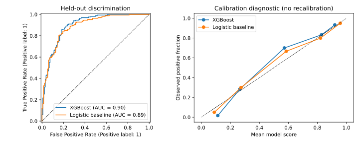
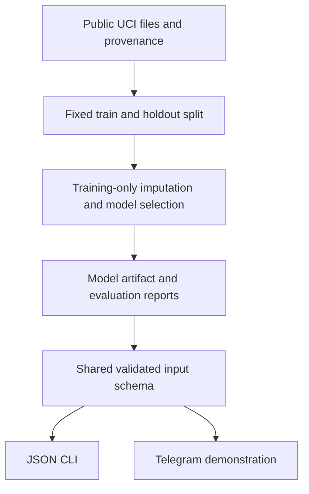

# CardioAlert

**Machine learning for educational cardiovascular screening research.**

CardioAlert trains and evaluates a heart-disease classifier on the public UCI
Heart Disease data and exposes the same validated feature contract through a
JSON command line and an optional Telegram demonstration.

The project combines a reproducible ML experiment with the engineering needed
to use a trained model consistently: input validation, training-only
preprocessing, persisted models, documented limitations and tested conversation
state. It is an educational prototype, **not a diagnostic service or a validated
personal risk calculator**.

## Results you can inspect

The original Cleveland notebook was reconstructed and its saved headline metrics
were reproduced exactly. A second, newly executed experiment uses four UCI
centers and a held-out set of exactly 300 public records. These are retrospective
benchmarks; neither is a new supervised clinical pilot.

| Experiment / model | Training rows | Held-out rows | ROC-AUC | Accuracy |
|---|---:|---:|---:|---:|
| Cleveland / XGBoost | 242 | 61 | 0.9021 | 86.89% |
| Cleveland / logistic baseline | 242 | 61 | 0.9491 | 85.25% |
| Four-site UCI / XGBoost | 618 | 300 | 0.8998 | 82.67% |
| Four-site UCI / logistic baseline | 618 | 300 | 0.8885 | 82.33% |

The logistic baseline has higher AUC on Cleveland. The small difference between
models on the four-site holdout should not be interpreted as a demonstrated
clinical advantage. The XGBoost 95% bootstrap AUC intervals are **0.8214-0.9689**
and **0.8625-0.9313**, respectively.



Inspect [Cleveland metrics](reports/cleveland/metrics.json),
[300-record metrics](reports/multisite300/metrics.json),
[holdout predictions](reports/multisite300/holdout_predictions.csv),
[training-only CV results](reports/multisite300/cv_results.csv), and
[data/methods](docs/DATA_AND_METHODS.md). Reports include source hashes, exact
split IDs, parameters, environment versions and confusion matrices.

## Quick start

Use Python **3.11 or newer**. The committed experiment was run on Python 3.12.

```bash
git clone https://github.com/KaliyevArsen/CardioAlert.git
cd CardioAlert
python -m venv .venv
source .venv/bin/activate
# On Windows: .venv\Scripts\activate
python -m pip install -r requirements.txt

# Download the attributed, public UCI files.
cardioalert download-data

# Recreate the original study protocol (243 settings x 10 training CV folds).
cardioalert train --protocol cleveland

# Run a fictional example through the generated model.
cardioalert predict --input examples/fictional_complete.json
cardioalert predict --input examples/fictional_missing.json
```

Training writes a local `artifacts/cleveland/` directory containing the model,
metrics, figures and CSV evidence. Use `--jobs 1` on a small computer. The full
grid may take several minutes. Existing nonempty output directories are not
overwritten; specify a new `--output` path for a rerun.

The separate four-site experiment:

```bash
cardioalert train --protocol multisite300
cardioalert predict --model artifacts/multisite300/model.joblib \
  --input examples/fictional_complete.json
```

For a short **functionality-only** check:

```bash
cardioalert train --search smoke --output artifacts/smoke
python -m pytest -q
```

Smoke-test results are explicitly labeled and are not substitutes for the full
reports. The offline test suite uses fictional fixtures and makes no API calls.

## Demonstration

See [fictional input examples](examples/README.md),
[actual example outputs](examples/demo_outputs.json) and an
[offline bot conversation](examples/bot_transcript.txt).
These examples are not clinical records or evidence of patient usage.

Optional Telegram mode:

```bash
export TELEGRAM_BOT_TOKEN="your-token-from-BotFather"
export CARDIOALERT_MODEL="artifacts/cleveland/model.joblib"
cardioalert bot
```

The bot accepts private chats, validates the original UCI codes, supports
`/start`, `/cancel`, `/help` and `/privacy`, and clears in-memory input after
completion, cancellation or inactivity. The idle cleanup loop runs every 30
seconds. Use fictional inputs only. Telegram processes messages independently;
clearing bot memory does not remove Telegram's copies. No OpenAI key is needed,
and the bot does not impersonate a physician or generate treatment advice.

## Design



| Location | Purpose |
|---|---|
| `src/cardioalert/data.py` | Source download, cleaning and provenance |
| `src/cardioalert/training.py` | Fixed protocols, CV, baseline and reporting |
| `src/cardioalert/schema.py` | One feature contract for all interfaces |
| `src/cardioalert/predict.py` | Validated inference with model schema checks |
| `src/cardioalert/bot.py` | Tested conversation state and optional transport |
| `tests/` | Input, inference, isolation, expiry and pipeline regression tests |
| `reports/` | Newly executed experiments, including baseline results |
| `archive/` | Unmodified original notebook and bot |

## Limits and project history

- The target is the historical dataset's disease-presence label, not future events.
- A random split across four sites is not external-site validation. Missingness,
  site differences, historical sampling and small sample sizes limit interpretation.
- A 0.5 score threshold is an experimental classification rule, not a clinical cutoff.
- Joblib model files can execute code when loaded. Only load artifacts you generated
  or explicitly trust; the quick start generates them locally.
- The restored code and current reports are new work. The original files and
  history are preserved. No unavailable pilot logs or historical patient counts
  have been reconstructed from fictional data.

The author reports a Daryn national-final award and Kazakhstan utility-model
patent No. 11198 for the project. See [project history and evidence](docs/PROJECT_HISTORY.md)
for source links, original metrics, contribution context and the distinction
between historical material and the current restoration.

## Data credit

Janosi, A., Steinbrunn, W., Pfisterer, M., & Detrano, R. (1989).
**Heart Disease**, UCI Machine Learning Repository.
[DOI: 10.24432/C52P4X](https://doi.org/10.24432/C52P4X), **CC BY 4.0**.
The source dataset authors did not endorse this project or its screening interface.
